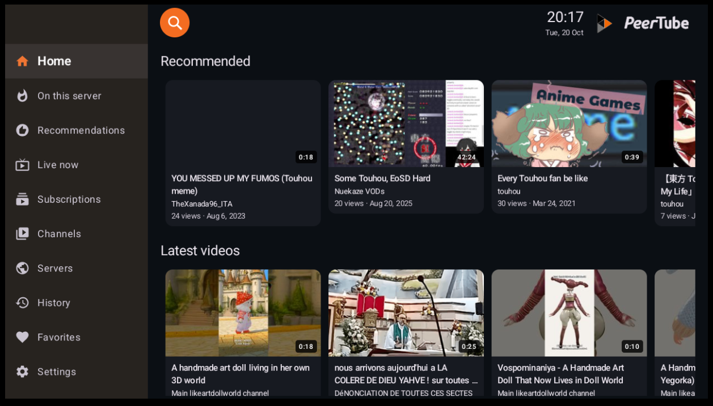
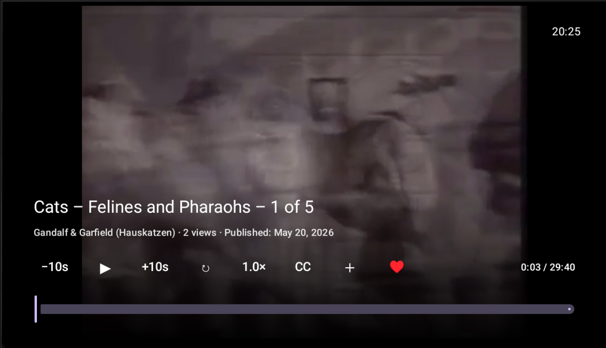

# PeerIcheTV

**PeerTube client for Android TV, built with Kotlin and Media3.**

PeerIcheTV connects to PeerTube servers that expose the public PeerTube API. The app is designed for Android TV devices and is controlled with a TV remote.

The interface design was inspired by [SmartTube](https://github.com/yuliskov/SmartTube), an Android TV media client. PeerIcheTV is an independent project and is not affiliated with SmartTube.

[Download the latest APK](https://github.com/alex-rek/PeerIcheTV/releases/latest) · [Русская версия](README_RU.md)

## Features

- Browse videos from a selected PeerTube server and discover videos through Sepia Search.
- Search indexed live streams and broadcasts that ended within the last 24 hours.
- Explore servers and channels, and keep a local list of followed channels.
- Save watch history and favorites, resume playback, and get recommendations based on viewing history.
- Play video with Android Media3 / ExoPlayer, including available subtitles.
- Adjust playback, interface, and display settings.
- Choose the Graphite, Light, PeerTube, or Blue interface theme.
- Show recommendations on the Android TV home screen when the device supports it and the app has permission.

Features can vary with the selected server and the availability of videos in the search index.

## Screenshots




## Download and install

Download the APK from the [Releases page](https://github.com/alex-rek/PeerIcheTV/releases/latest) and install it on an Android TV device. Android may ask you to allow installation from the app used to open the APK.

## Build from source

### Requirements

- Android Studio
- JDK 17
- Android SDK Platform 35

### Debug APK

Clone the repository, open its folder in Android Studio, and allow Gradle sync to finish. Or run from PowerShell in the project root:

```powershell
.\gradlew.bat assembleDebug
```

The APK is generated at `app/build/outputs/apk/debug/app-universal-debug.apk`.

### Baseline profile

Release builds ship a baseline profile (`app/src/release/generated/baselineProfiles`) that speeds up startup and the first screens on TV boxes. After larger UI changes, regenerate it on a connected Android TV device (Android 13+, no root needed):

```powershell
$env:ANDROID_SERIAL = "<device serial>"; .\gradlew.bat :app:generateBaselineProfile
```

`.\gradlew.bat :baselineprofile:connectedBenchmarkReleaseAndroidTest` compares cold start with and without the profile. Both tasks reinstall the app on the device, which clears its data.

### Signed release APK

In Android Studio, choose **Build → Generate Signed Bundle / APK → APK**, select the `release` variant, and sign it with your own keystore. Keep the keystore and its passwords in a safe place; do not commit or upload them.

## Technology

- Kotlin and Jetpack Compose
- Android Media3 / ExoPlayer
- Retrofit and Gson
- Coil for image loading
- PeerTube API and Sepia Search

Interface string resources are included for English, Russian, Arabic, German, Spanish, French, Hindi, Italian, Japanese, Portuguese, and Simplified Chinese; translation coverage may vary.

## Project status

This project is under active development. PeerTube servers differ in their API behavior, video formats, and availability. The repository does not currently include a license file.
