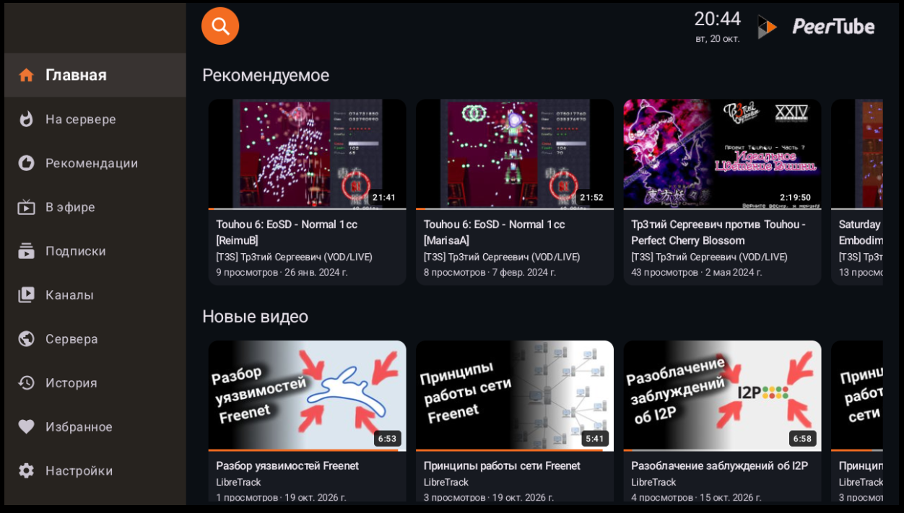
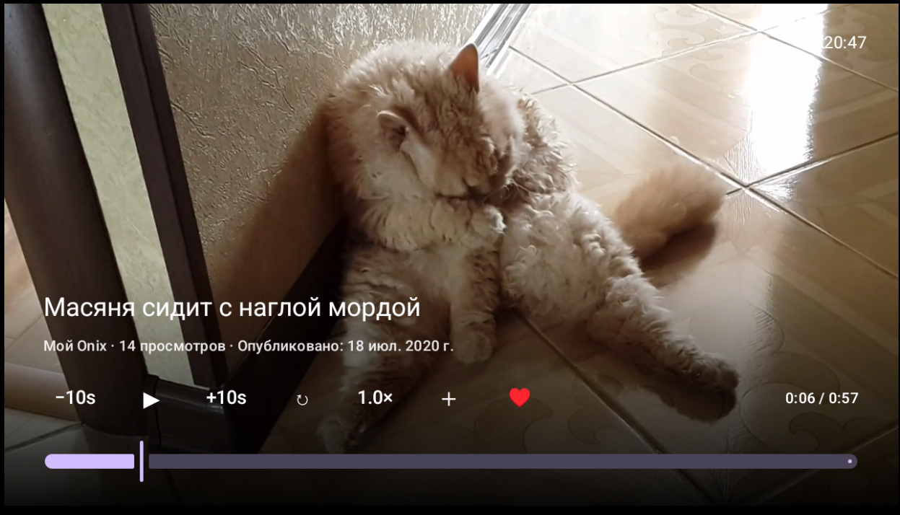

# PeerIcheTV

**Клиент PeerTube для Android TV на Kotlin и Media3.**

PeerIcheTV подключается к серверам PeerTube с открытым API. Приложение рассчитано на устройства Android TV и управление пультом.

Дизайн интерфейса вдохновлён проектом [SmartTube](https://github.com/yuliskov/SmartTube) — медиаклиентом для Android TV. PeerIcheTV — независимый проект, не связанный с SmartTube.

[Скачать последнюю версию APK](https://github.com/alex-rek/PeerIcheTV/releases/latest) · [English](README.md)

## Возможности

- Просмотр видео с выбранного PeerTube-сервера и поиск через Sepia Search.
- Поиск текущих трансляций и трансляций, завершившихся за последние 24 часа.
- Просмотр серверов и каналов, локальный список каналов.
- История просмотров, избранное, продолжение воспроизведения и рекомендации на основе истории.
- Воспроизведение через Android Media3 / ExoPlayer, включая доступные субтитры.
- Настройки воспроизведения и интерфейса.
- Четыре темы интерфейса: «Графитовая», «Светлая», «PeerTube» и «Синяя».
- Отображение рекомендаций на главном экране Android TV, если устройство и разрешения это поддерживают.

Доступность функций зависит от выбранного сервера и индекса поиска видео.

## Скриншоты




## Скачать и установить

Скачайте APK со страницы [Releases](https://github.com/alex-rek/PeerIcheTV/releases/latest) и установите на устройство Android TV. Android может попросить разрешить установку приложений из источника, которым вы открыли APK.

## Сборка из исходного кода

### Требования

- Android Studio
- JDK 17
- Android SDK Platform 35

### Debug APK

Клонируйте репозиторий, откройте папку проекта в Android Studio и дождитесь завершения синхронизации Gradle. Или выполните из корневой папки проекта в PowerShell:

```powershell
.\gradlew.bat assembleDebug
```

APK появится по пути `app/build/outputs/apk/debug/app-universal-debug.apk`.

### Baseline Profile

В release-сборки входит baseline profile (`app/src/release/generated/baselineProfiles`), который ускоряет запуск и первые экраны на ТВ-приставках. После крупных изменений интерфейса обновите его на подключённом устройстве Android TV (Android 13+, root не нужен):

```powershell
$env:ANDROID_SERIAL = "<серийный номер устройства>"; .\gradlew.bat :app:generateBaselineProfile
```

`.\gradlew.bat :baselineprofile:connectedBenchmarkReleaseAndroidTest` сравнивает холодный старт с профилем и без него. Обе задачи переустанавливают приложение на устройстве и стирают его данные.

### Подписанный release APK

В Android Studio выберите **Build → Generate Signed Bundle / APK → APK**, вариант `release` и подпишите сборку своим ключом. Надёжно сохраните файл хранилища ключей и пароли; не добавляйте их в Git и не загружайте на GitHub.

## Технологии

- Kotlin и Jetpack Compose
- Android Media3 / ExoPlayer
- Retrofit и Gson
- Coil для загрузки изображений
- PeerTube API и Sepia Search

Строковые ресурсы интерфейса включают английский, русский, арабский, немецкий, испанский, французский, хинди, итальянский, японский, португальский и упрощённый китайский языки; покрытие переводами может различаться.

## Статус проекта

Проект активно развивается. Серверы PeerTube могут отличаться поведением API, форматами видео и доступностью.

## Лицензия

Copyright 2026 alex-rek. Распространяется по [лицензии Apache 2.0](LICENSE).

Сторонние библиотеки распространяются по своим лицензиям; Google ML Kit (перевод на устройстве) используется на условиях Google ML Kit Terms of Service.
